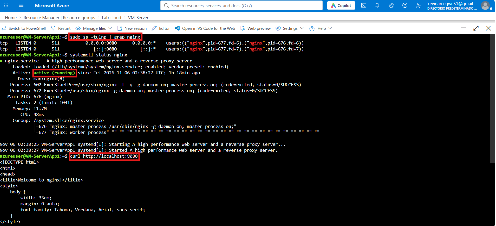
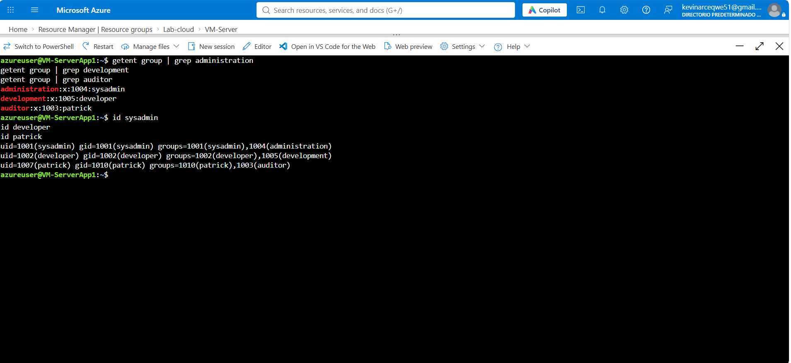
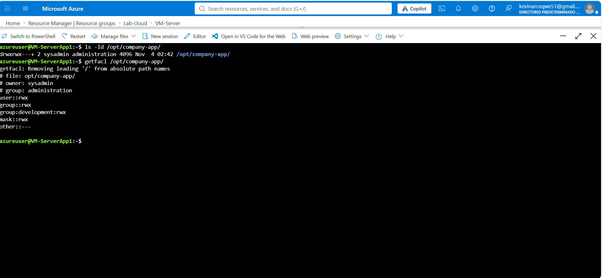
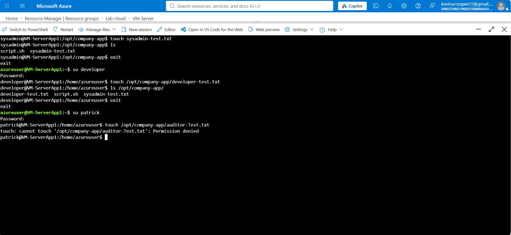

# Linux Server Administration Lab

## Project Overview

This project demonstrates hands-on experience with Linux server administration, user and group management, file system permissions, Access Control Lists (ACLs), and Nginx service configuration.

The lab focuses on implementing access control through Linux ownership, group permissions, and ACLs, following the principle of least privilege.

The objective was to configure a Linux environment where different users have specific access permissions to application directories, while also configuring and validating an Nginx web server running on a custom port.

## Environment

- **Operating System:** Ubuntu Linux
- **Web Server:** Nginx
- **Service Port:** TCP 8080
- **User Management:** Linux Users and Groups
- **Permissions Management:** chmod, chown
- **Access Control:** POSIX Access Control Lists (ACLs)
- **Directory:** /opt/company-app/

## Implemented Configurations

### 1. Nginx Service Configuration

- Installed and configured Nginx.
- Changed the default HTTP listening port to 8080.
- Verified the listening port using `ss -lntp`.
- Checked service status using `systemctl status nginx`.
- Tested HTTP connectivity using `curl`.

### 2. Linux User and Group Management

Created and organized Linux users into the following groups:

- **administration**
- **development**
- **auditor**

Used `getent group` to verify group membership and `id` to inspect individual user and group assignments.

### 3. File System Permissions and ACL Configuration

Configured access permissions for `/opt/company-app/` using ownership management and POSIX ACLs.

- Assigned `sysadmin` as the directory owner using `chown`.
- Assigned `administration` as the directory's primary group.
- Configured read, write, and execute permissions for the owner and primary group.
- Added an ACL entry granting the `development` group read, write, and execute permissions.
- Restricted access for other users.

**Directory permissions:**

```bash
drwxrwx---+ 2 sysadmin administration 4096 /opt/company-app/
```

**ACL configuration:**

```text
# file: opt/company-app/
# owner: sysadmin
# group: administration

user::rwx
group::rwx
group:development:rwx
mask::rwx
other::---
```

### 4. Access Validation and Least Privilege

Performed access validation by logging in with users belonging to different groups.

- **sysadmin (administration):** Successfully created files inside the application directory.
- **developer (development):** Successfully created files through the permissions granted by the ACL.
- **patrick (auditor):** Could not create files because the auditors group was not granted write permissions.

These tests verified that directory access was restricted according to the configured ownership, group membership, and ACL permissions.

## Screenshots

### 01. Nginx Service and Port Configuration

Verified that Nginx was running and listening on TCP port 8080 using `ss`, `systemctl`, and `curl`.



### 02. Linux Users and Groups

Verified Linux group membership and individual user information using `getent` and `id`.



### 03. ACL Configuration and Least Privilege

Displayed directory ownership, standard Linux permissions, and ACL entries configured for the administration and development groups.



### 04. Access Validation

Tested directory access using different user accounts, confirming that authorized users could create files while the auditors user was denied write access.



## Skills Demonstrated

- Linux Server Administration
- Linux User and Group Management
- File Ownership and Permissions
- Access Control Lists (ACLs)
- Least Privilege Principle
- Nginx Installation and Configuration
- Linux Service Management (systemctl)
- Network Socket Verification (ss)
- HTTP Connectivity Testing (curl)
- Linux Access Control Troubleshooting

## Project Purpose

This lab was developed as part of my continuous learning journey in Systems Administration and Cloud Infrastructure, focusing on practical Linux administration, service configuration, access management, and security fundamentals.
